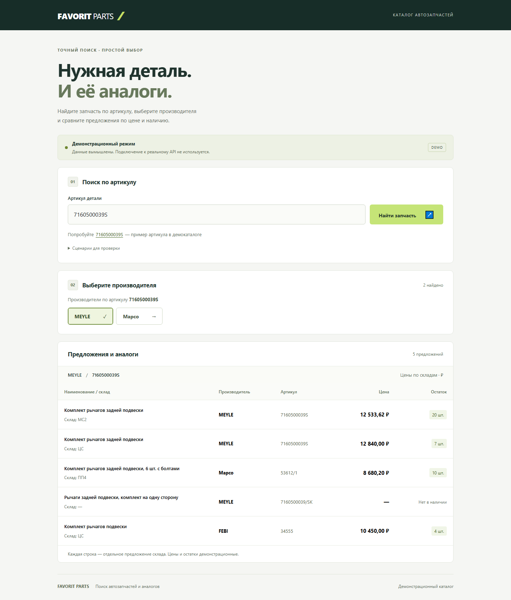
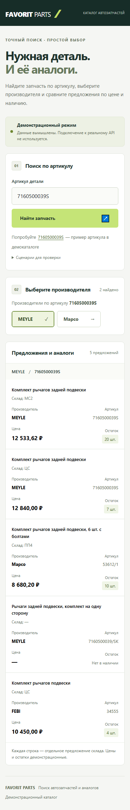
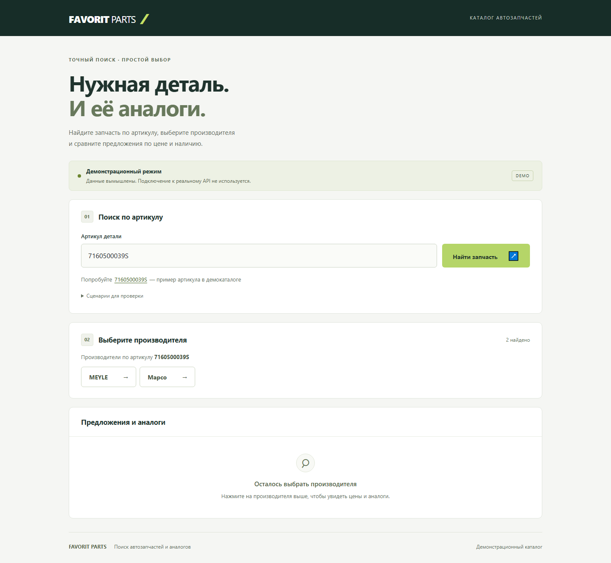

# Favorit Parts — Parts Search

Двухэтапный поиск автозапчастей и аналогов на React: введите артикул, выберите производителя и сравните предложения складов.

[](https://github.com/toshnotik/Favorit-parts/actions/workflows/pages.yml)

## Live Demo

[Открыть приложение →](https://toshnotik.github.io/Favorit-parts/)

Демоартикул: **`7160500039S`**.

## Screenshots

Поиск по артикулу **7160500039S**, производитель **MEYLE**.

**Десктоп — таблица предложений**



<details>
<summary>Мобильная версия — карточки результатов</summary>



</details>

<details>
<summary>Выбор производителя</summary>



</details>

## Features

- Поиск производителей по артикулу и загрузка аналогов после выбора.
- Цены и остатки по каждому складу, включая позиции без наличия.
- Таблица на десктопе и карточки на мобильных экранах.
- Состояния загрузки, ошибки и пустые результаты.
- Повторный поиск и смена производителя с защитой от устаревших ответов.

## Tech Stack

React · JavaScript · Vite · Redux Toolkit · Bootstrap 5 · CSS  
Тесты: Vitest · React Testing Library.

## Getting Started

Node.js **22.12+** и npm.

```sh
git clone https://github.com/toshnotik/Favorit-parts.git
cd Favorit-parts
npm ci
npm run dev
```

```sh
npm test            # тесты
npm run build      # production-сборка
npm run preview    # просмотр сборки
```

> Приложение использует демонстрационные данные по контракту API Favorit Parts. Для подключения реального API нужен ключ доступа; предусмотрен серверный прокси, чтобы ключ не попадал в клиентский код.
